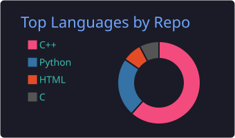

# Hi there, I'm Mehadi Hasan 👋

### Competitive Programmer | C++ Developer | Python Learner

I'm a Computer Science & Technology student passionate about problem-solving, programming, and software development.

- 🔭 Currently working on **Competitive Programming**
- 🌱 Learning **Python OOP and Database Management**
- 💻 Primary Language: **C++**
- 📚 Practicing Data Structures & Algorithms
- 🎯 Goal: Become a better problem solver and software developer.

---

### 🛠️ Languages & Technologies

  

---

### 📂 My Learning & Projects

| Repository | Description |
|---|---|
| OOP and Python Programming | Learning Python and Object-Oriented Programming |
| CP Learning Journey | My Competitive Programming journey |
| OOP Project | Practical projects using Python OOP |
| DSA Foundation | Data Structures and Algorithms fundamentals |

---

### 📊 GitHub Statistics

  
  

  

---

### 🌐 Connect With Me

- GitHub: [@mehadi977](https://github.com/mehadi977)
- Codeforces: [@mehadi977](https://codeforces.com/profile/mehadi977)
- LeetCode: [@mehadi977](https://leetcode.com/u/mehadi977/)

---

  <i>"Consistency is the key to becoming a better programmer."</i>

