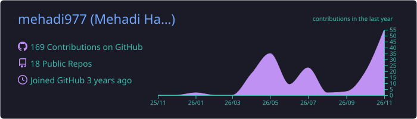
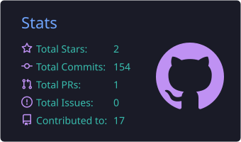
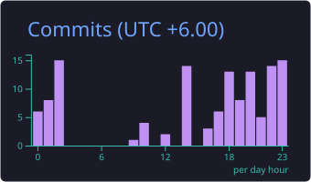
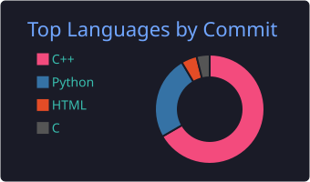

<h1 align="center">Hi, I'm Mehadi Hasan 👋</h1>

  Competitive Programmer · CS Student · Aspiring Software Developer

  
  
  
  

---

## 🧭 Roadmap

| Stage | Focus |
|:---:|---|
| ✅ **Done** | C++ · Problem Solving · DSA |
| 🔄 **Now** | Python OOP · Database Management |
| 🚀 **Next** | Software Development Projects |

---

## 🛠️ Tech Stack

  

---

## 📚 Repositories

| Repository | Focus |
|---|---|
| [CP Learning Journey](https://github.com/mehadi977/CP-Learning-Journey) | Competitive Programming |
| [OOP and Python Programming](https://github.com/mehadi977/OOP-and-Python-Programming) | Python & OOP |
| DSA Foundation | Data Structures & Algorithms |
| OOP Project | Python Projects |

---

## 📊 GitHub Stats

  

  
  

  

---

<i>"Learn, Build, Improve, Repeat."</i>

